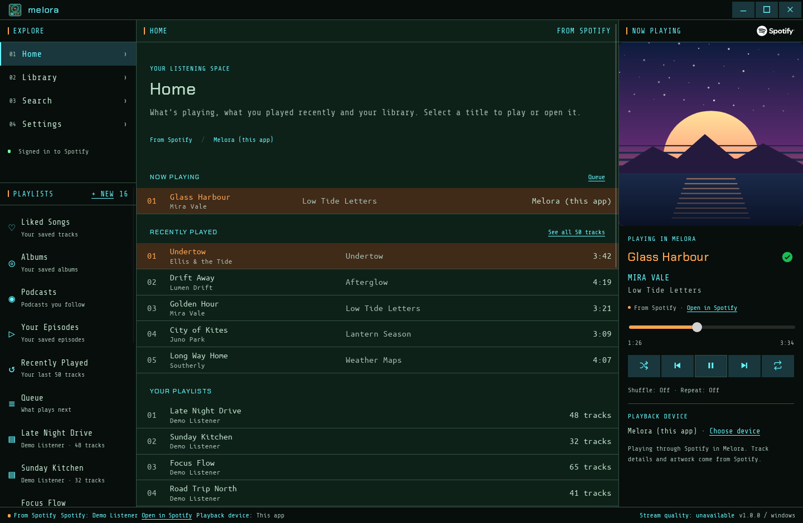
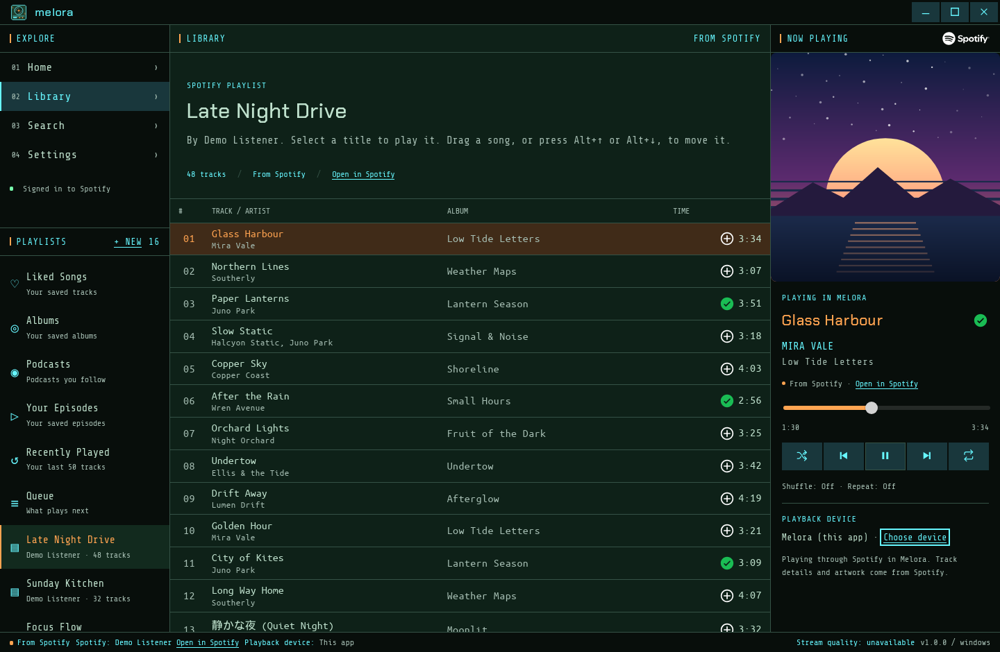
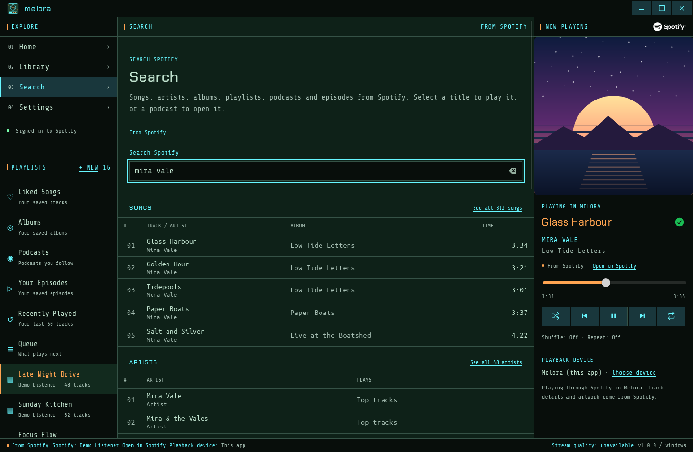
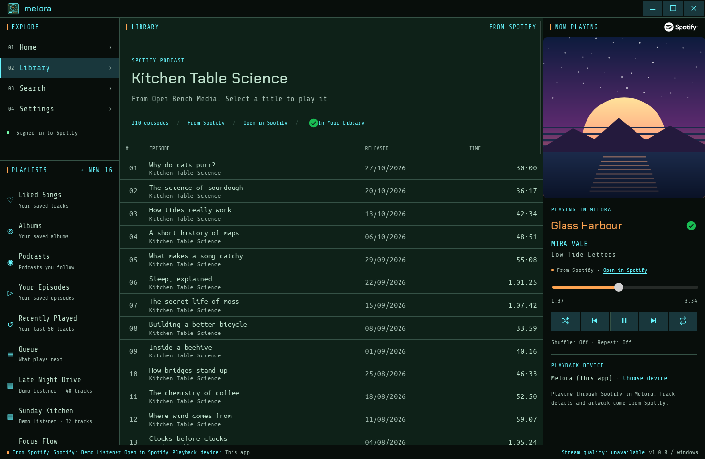
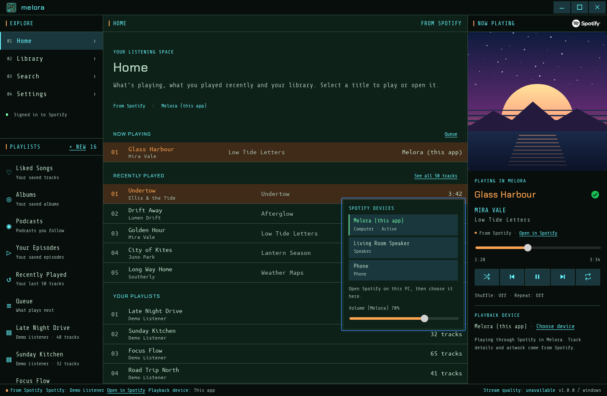

# Melora

Melora is a desktop music client for Spotify, for Windows and Linux. It shows your playlists, library, podcasts and search in one window, plays Spotify inside the app on Windows, and controls Spotify on your other devices.

Melora is unofficial. It is not affiliated with, endorsed by or sponsored by Spotify.



## Screenshots

The screenshots use made-up music, artwork and a demo account, so they contain nobody's real data.

|                                                                                              |                                                                                         |
| -------------------------------------------------------------------------------------------- | --------------------------------------------------------------------------------------- |
|  |        |
| A playlist and its tracks                                                                    | Search                                                                                  |
|    |  |
| A podcast's episodes                                                                         | Choosing a device                                                                       |

Before you sign in, Melora shows its welcome and points you to Settings:

|                                                                       |                                                                                    |
| --------------------------------------------------------------------- | ---------------------------------------------------------------------------------- |
|  |  |
| Welcome                                                               | Settings                                                                           |

## What you need

- 64-bit Windows with the Microsoft Edge WebView2 Runtime, which current Windows versions already have. Or Linux: Fedora, Ubuntu 22.04 or later, Debian 12 or later, or another x86_64 distribution through the AppImage.
- A Spotify account. Playing music inside Melora needs Spotify Premium.
- A free Spotify developer app of your own, which takes a few minutes to set up (see below). Melora has no shared app or server.

## Install

Melora is built from source; see [DEVELOPMENT.md](DEVELOPMENT.md) for the build commands.

**Windows.** The build makes a portable ZIP, `Melora-<version>-windows-x64.zip`. Extract the whole ZIP to a folder you can write to, such as one in your Documents, and run `Melora.exe`. There is no installer, and the builds are unsigned.

**Linux.** The build makes these packages:

| Package                                           | For                                                | Install                                            |
| ------------------------------------------------- | -------------------------------------------------- | -------------------------------------------------- |
| `Melora-<version>-1.x86_64.rpm` or `.aarch64.rpm` | Fedora (Asahi Remix on Apple silicon uses aarch64) | `sudo dnf install ./Melora-<version>-1.x86_64.rpm` |
| `Melora_<version>_amd64.deb` or `_arm64.deb`      | Ubuntu 22.04 or later, Debian 12 or later          | `sudo apt install ./Melora_<version>_amd64.deb`    |
| `Melora_<version>_amd64.AppImage`                 | other x86_64 distributions                         | `chmod +x` it, then run it                         |

The packages add Melora to your app menu and use the system's WebKitGTK. The AppImage carries its own copy, so use a package where there is one. Melora keeps your Spotify sign-in in the desktop's keyring (GNOME Keyring or KWallet), which must be running. To uninstall, run `sudo dnf remove melora` or `sudo apt remove melora`.

## Set up Spotify (once)

Spotify only lets apps sign in through a developer app that someone has registered. Melora uses yours, so it never needs a password, a Client Secret or a server.

1. Go to the [Spotify Developer Dashboard](https://developer.spotify.com/dashboard), sign in and choose **Create app**. Give it any name and description.
2. Under **Redirect URIs**, add exactly `http://127.0.0.1:43821/callback` and save. It starts with `http`, not `https`, and includes the port. The Dashboard may show a "not secure" notice for it, which is expected for this local address.
3. Tick **Web API** and **Web Playback SDK** for the APIs the app uses.
4. Open the app's **User Management** and add every Spotify account that will use Melora, including your own. Spotify refuses accounts that aren't listed.
5. Copy the app's **Client ID**.
6. In Melora, open **Settings**, paste the Client ID under **Spotify account**, choose **Save**, then **Sign in with Spotify**. Your browser opens Spotify's approval page. Approve it and go back to Melora.

The first time you use a feature, such as your playlists, the player or Liked Songs, Melora asks Spotify for that one permission. Your browser opens again to approve it, and Melora keeps working in the meantime. **Cancel sign-in** in Settings stops waiting.

Spotify's Development Mode applies to these apps. The developer app's owner needs Spotify Premium, at most five accounts can use it, and a sign-in lasts up to six months before you sign in again.

## Using Melora

The window has three columns. On the left are the main sections (Home, Library, Search and Settings) and the sidebar with your library and playlists. The middle shows what you choose. On the right is the player.

### Play music

- **Select a title** in any list to play it. A podcast in a list opens to show its episodes.
- **In Melora (Windows, Premium).** Once you allow playback, Melora becomes a Spotify device each time it opens, so it appears in your device lists. Settings, under **Playback in Melora**, shows whether it's ready and why not.
- **On another device.** Start Spotify on your phone, computer or speaker, and Melora's player shows what's playing there and controls it. On Linux this is how Melora plays, because WebKitGTK can't play Spotify's protected audio.
- **Choose device** under the player moves the music between Melora and your other devices. Its volume slider sets the volume of the device that's playing.
- The player has shuffle, previous, play or pause, next and repeat, and a bar to move through the track. In a podcast, the buttons beside Play skip back and forward 15 seconds.
- The **+** beside the track title adds it to your Liked Songs, or removes it.

### Your library

- **Liked Songs**, **Albums**, **Podcasts**, **Your Episodes**, **Recently Played** (your last 50 tracks) and **Queue** (what plays next) are at the top of the sidebar, followed by your playlists.
- Open an album or podcast to see its tracks or episodes. The **+** beside its name saves it to your library or removes it. Every song row has a **+** for Liked Songs too.
- **Home** shows what's playing, what you played recently, your playlists, albums and podcasts, and your devices.
- Spotify only shows the tracks of playlists you own or collaborate on. You can still play the others, or open them in Spotify.

### Search

Open **Search** and type. Results come in as you type, in groups: songs, artists, albums, playlists, podcasts and episodes. **See all** shows more of one group.

### Playlists

- **+ New** in the sidebar creates a private playlist.
- Right-click a song or episode to add it to the queue or to one of your playlists.
- In a playlist you own or collaborate on, drag a song to move it, or remove it from its right-click menu. The change is made on Spotify too. If Spotify refuses it, Melora puts the list back and says why.
- Drag playlists in the sidebar to put them in your own order. Melora keeps that order on this computer and leaves Spotify's order alone. **Use Spotify's order** in a playlist's right-click menu goes back.

### Keyboard and media keys

| Keys                                     | What they do                                                                                                   |
| ---------------------------------------- | -------------------------------------------------------------------------------------------------------------- |
| Menu key or Shift+F10                    | Opens the right-click menu of the selected row                                                                 |
| Alt+↑ and Alt+↓                          | Move the selected song in a playlist, or the selected playlist in the sidebar                                  |
| Esc                                      | Closes a menu, the device list or the new playlist form                                                        |
| Play/pause, next and previous media keys | Control what the player shows, in Melora or on another device. In a podcast, next and previous skip 15 seconds |

The system's media controls also work: the media overlay on Windows, and the desktop's media controls on Linux (through MPRIS).

### Settings

- **Interface scale** makes everything larger, from 100% to 200%.
- **Comfortable track rows** gives lists more space.
- **Volume** is Melora's own playback volume.
- **Spotify account** is where you set the Client ID, sign in and sign out.

## Your data

- Melora talks only to Spotify. It has no analytics, ads, tracking or server of its own. Its fonts and icons are inside the app; artwork comes from Spotify.
- Your Spotify sign-in is kept in the system's credential store: Windows Credential Manager, or the keyring on Linux. Melora never stores your password and never asks for it.
- On Windows, settings and your Client ID are saved in the `data` folder beside `Melora.exe`. Moving the folder to another computer means signing in again. On Linux they are in `~/.local/share/app.melora.desktop/`.
- Signing out in Settings removes the sign-in from the credential store.

## If something goes wrong

- **"Spotify refused access."** Add the account to the developer app's **User Management** (step 4 above).
- **Spotify shows an error about the redirect URI.** The Redirect URI in the Dashboard must be exactly `http://127.0.0.1:43821/callback`.
- **Melora can't play music itself.** It needs Spotify Premium and Windows. On Linux, start Spotify on another device and Melora controls it.
- **Linux: Melora signs you out every time it closes.** The keyring isn't running. Start GNOME Keyring or KWallet and sign in again.

## Platforms

- **Windows** is the main platform. Melora plays Spotify itself there, or controls another device.
- **Linux** packages are for x86_64 and aarch64, tested on Fedora first. Melora controls Spotify on another device. Spotify has no Linux app for aarch64, so on Apple silicon (Asahi) Melora controls a phone, a speaker or another computer.
- **macOS** is on hold. A macOS build needs a Mac to build on, and macOS's WebView can't play Spotify's protected audio either, so it would only control other devices.

## Build it yourself

To try the interface in a browser (signed out, nothing to sign in to), use Node 22.22.1 or later:

```sh
npm ci
npm run dev
```

For the desktop app, the Windows ZIP and the Linux packages, see [DEVELOPMENT.md](DEVELOPMENT.md).

## Licences

Melora's own source is under the [MIT License](LICENSE). The bundled fonts keep their own licences, and the Spotify logo and Like icons are Spotify's trademarks, used as Spotify's guidelines require and not covered by Melora's licence. See [THIRD_PARTY_NOTICES.md](THIRD_PARTY_NOTICES.md). Dependencies keep their own licences.
