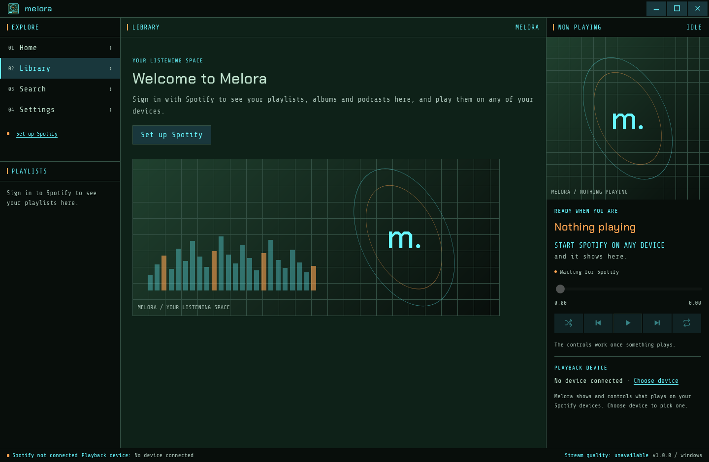
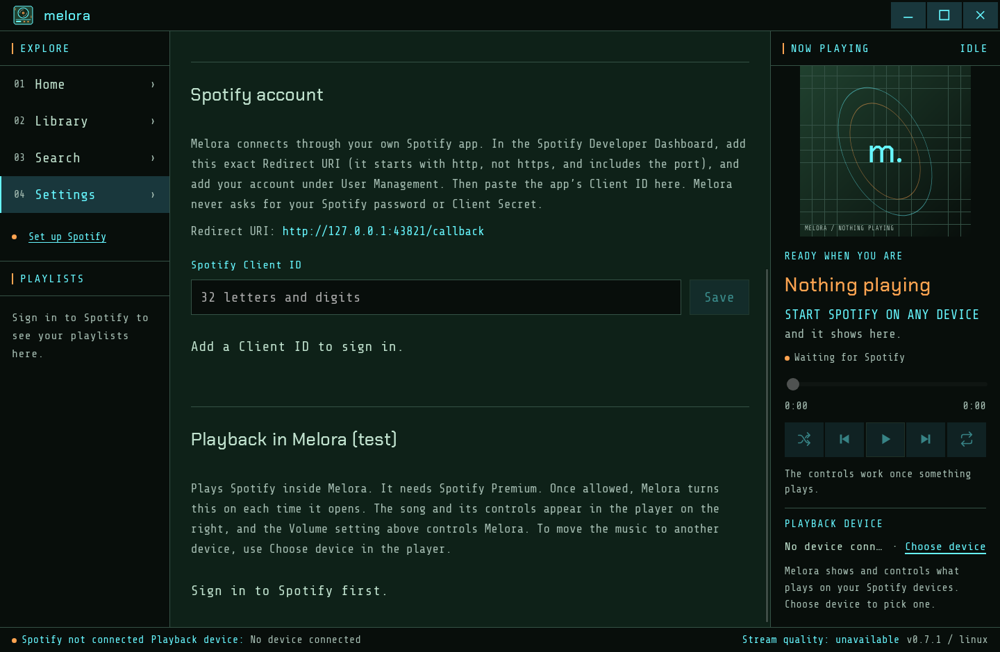

# Melora

Melora is a personal desktop music client built with Tauri 2, Rust, React and TypeScript. Windows and Linux are its targets; macOS is on hold (see [Platforms](#platforms)).

Until you sign in, Melora welcomes you with its own artwork and a way to set up Spotify; nothing in it is invented music. Sign in to Spotify in Settings to see your account and your own music. With Spotify Premium you can also play Spotify inside Melora (Settings → Playback in Melora, through Spotify's Web Playback SDK); while it plays, the player shows the real track, artwork and controls. The player can also show and control what's playing on your other Spotify devices (a phone, the Spotify app, a speaker), and **Choose device** moves the music between them and Melora. The **+** beside the track title adds it to your Liked Songs or removes it. While a podcast plays, the buttons beside Play skip back or forward 15 seconds. Your keyboard's media keys (play/pause, next, previous) and the system's media controls (Windows' media overlay, or the Linux desktop's through MPRIS) control whatever the player shows, in Melora or on another device; in a podcast, next and previous skip 15 seconds there too. Once you allow it, the sidebar lists your Spotify playlists and Liked Songs: choose one to see its tracks, and select a title to play it (Spotify only shows the tracks of playlists you own or collaborate on). The sidebar also lists your saved **Albums**, **Podcasts** and **Your Episodes**: open an album or podcast to see its tracks or episodes, and save or remove it with the **+** beside its name. Every song row has a **+** for Liked Songs too. Signed in, **Search** finds songs, artists, albums, playlists, podcasts and episodes on Spotify as you type; select one to play it (a podcast opens), or **See all** for more of one kind. Long lists stay quick: only the rows on screen are drawn. **Home** shows what's playing, what you played recently, your playlists, saved albums and podcasts, and your devices. The sidebar's **Recently Played** lists your last 50 tracks, and **Queue** shows what plays next; Spotify doesn't let other apps reorder the queue. Right-click a song or episode (or press the Menu key or Shift+F10) to add it to the queue or to one of your playlists. **+ New** in the sidebar creates a private playlist. In a playlist you own or collaborate on, drag a song (or press Alt+↑ or Alt+↓) to move it, or remove it from its menu; the change is made on Spotify too. You can also put the sidebar's playlists in your own order by dragging them or with Alt+↑ and Alt+↓; Melora keeps that order on this device and leaves Spotify's order as it is (**Use Spotify’s order** goes back). Melora is unofficial and is not affiliated with, endorsed by or sponsored by Spotify.

## Screenshots





Both show Melora on Linux before signing in, so they contain no account data. Signed in, your playlists, library, search results and the music playing on your devices fill the same layout.

## Run in a browser

Use Node 22.22.1 or later:

```sh
npm ci
npm run dev
```

Open the local address printed by Vite. Browser settings last for the current session. The native app saves preferences on the device.

For native development and portable builds, see [DEVELOPMENT.md](DEVELOPMENT.md).

## Windows (portable)

The build command produces `artifacts/Melora-<version>-windows-x64.zip`. Extract the complete ZIP to a writable folder and launch `Melora.exe`. No installer is required. The system Microsoft Edge WebView2 Runtime is required and is not bundled. Builds are unsigned.

Preferences are saved in `data/preferences.json` beside the executable, and your Spotify Client ID in `data/spotify.json`. An unwritable folder produces a visible error. The Spotify refresh token is stored only in Windows Credential Manager (macOS Keychain or Linux Secret Service elsewhere); moving the portable folder to another computer requires signing in again.

Compilation and runtime verification are separate: each Windows build is tested by hand on Windows.

## Linux

`npm run build:linux` produces packages in `artifacts/linux/` (see [DEVELOPMENT.md](DEVELOPMENT.md#linux-packages)):

| Package                                                           | For                                                | Install                                            |
| ----------------------------------------------------------------- | -------------------------------------------------- | -------------------------------------------------- |
| `Melora-<version>-1.x86_64.rpm`, `Melora-<version>-1.aarch64.rpm` | Fedora (Asahi Remix on Apple silicon uses aarch64) | `sudo dnf install ./Melora-<version>-1.x86_64.rpm` |
| `Melora_<version>_amd64.deb`, `Melora_<version>_arm64.deb`        | Ubuntu 22.04 or later, Debian 12 or later          | `sudo apt install ./Melora_<version>_amd64.deb`    |
| `Melora_<version>_amd64.AppImage`                                 | other x86_64 distributions                         | `chmod +x` it, then run it                         |

The packages install `melora` with a desktop entry and icons, and use the system's WebKitGTK; the AppImage carries its own (from Ubuntu 22.04, with their copyright notices inside), so prefer a package where there is one. Settings live in `~/.local/share/app.melora.desktop/`, and the Spotify refresh token in the desktop's Secret Service (GNOME Keyring or KWallet), which must be running. Packages are unsigned. Uninstall with `sudo dnf remove melora` or `sudo apt remove melora`.

## Platforms

- **Windows** is the main target, as the portable ZIP above. Melora can play Spotify itself there, or control another device.
- **Linux** packages are above (Fedora first; x86_64 and aarch64). WebKitGTK can't play Spotify's protected audio, so on Linux Melora controls Spotify playing on another device: the Spotify app, a phone or a speaker. Spotify has no Linux app for aarch64, so on Apple silicon (Asahi) Melora controls a phone, a speaker or another computer.
- **macOS is on hold, to revisit later.** A macOS build has to be made on a Mac with Xcode's Command Line Tools; it can't be built on Linux or Windows. Running a build you made yourself on your own Mac needs no paid Apple Developer account. Giving it to other people without macOS's "unidentified developer" warning does (Developer ID signing and notarisation, $99 a year); the App Store isn't needed either way. macOS's WebView has no Widevine, so Melora would probably control other devices only, as on Linux. To pick it up again: build on a Mac (`npm run tauri build`), test sign-in, device control and media keys, then decide about the developer account.

## Spotify configuration

Melora uses your own Spotify app (bring your own Client ID) and Authorization Code with PKCE. It never uses or asks for a Client Secret or your Spotify password.

1. In the [Spotify Developer Dashboard](https://developer.spotify.com/dashboard), create an app. Add the Redirect URI `http://127.0.0.1:43821/callback` exactly. It starts with `http`, which Spotify permits for loopback addresses (the Dashboard shows a generic "not secure" notice), and it must include the port: the Dashboard refuses the port-less form. Melora listens on that port only while you sign in, and Settings shows the exact URI. Tick **Web API** and **Web Playback SDK**.
2. Under **User Management**, add every Spotify account that will sign in, including your own. Spotify answers other accounts with "forbidden" errors.
3. In Melora, open **Settings → Spotify account**, paste the app's Client ID, save, and choose **Sign in with Spotify**. Your browser opens Spotify's approval page.

Melora requests only the scopes the current features need: your profile at sign-in, then more the first time you use playback, your devices, Liked Songs, your playlists, your podcasts or what you played recently. Access tokens stay in the native process memory; nothing is sent anywhere except Spotify. The intended mode is personal, non-commercial Spotify Development Mode, which needs the app owner to have Spotify Premium, allows up to five users and expires sign-ins after six months.

## Licences

Melora's own source is licensed under the [MIT License](LICENSE). Bundled fonts keep their original licences, and the Spotify logo and Like icons are Spotify's trademarks, used only as Spotify's guidelines require and not covered by Melora's licence; see [THIRD_PARTY_NOTICES.md](THIRD_PARTY_NOTICES.md). Dependencies keep their own licences.
